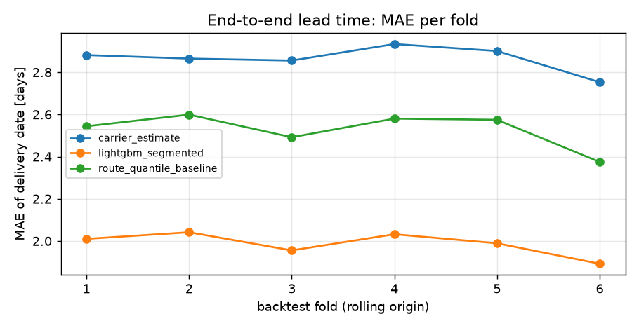
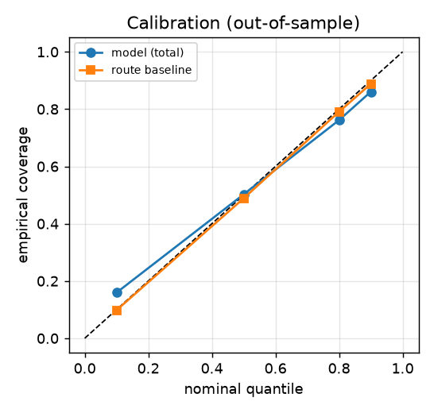
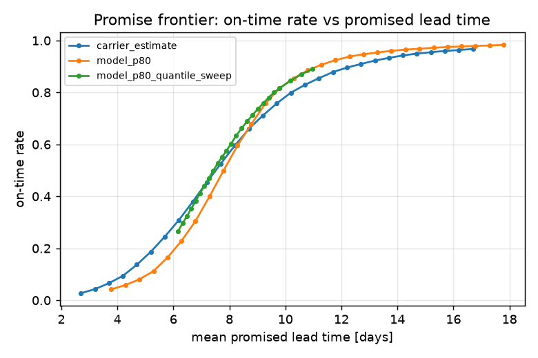
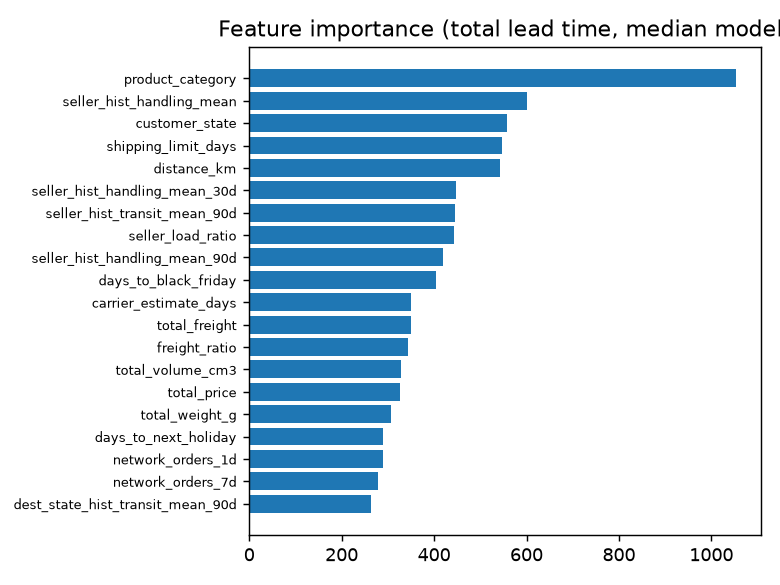

# Results of the shipped run

Synthetic Olist-shaped data (`leadtime synth`, 40k orders → 39,105 valid delivered orders,
2017-01 … 2018-08), LightGBM quantile models, 6 rolling-origin folds of 30 days each
(cutoffs 2018-03-04 … 2018-08-01, 21-day label gap), 46 features, 14,965 out-of-sample orders.
Raw tables: [docs/results/](results/). Regenerate with `make prototype`.

> These figures come from the synthetic generator that ships with the repository so that the code
> can be exercised offline. They describe the pipeline's behaviour, not the real Olist network; run
> `make olist && leadtime prepare && leadtime features && leadtime backtest` for real-data numbers.

## Forecast accuracy (mean over folds)

| stage | model | MAE [d] | bias [d] | mean pinball | cov. P50 | cov. P80 | cov. P90 |
|---|---|---|---|---|---|---|---|
| **total** | **LightGBM per segment** | **1.99** | -0.57 | 0.73 | 0.50 | 0.76 | 0.86 |
| total | carrier estimate | 2.86 | +0.57 | – | – | – | – |
| total | route empirical quantiles | 2.53 | -0.97 | 0.93 | 0.49 | 0.79 | 0.89 |
| total | sum of stage medians | 1.98 | – | – | – | – | – |
| approval | LightGBM | 0.08 | -0.05 | 0.04 | 0.47 | 0.79 | 0.92 |
| handling | LightGBM | 1.23 | -0.31 | 0.44 | 0.52 | 0.77 | 0.86 |
| transit | LightGBM | 1.24 | -0.44 | 0.48 | 0.50 | 0.76 | 0.87 |

* Delivery-date MAE **1.99 vs 2.86 days (-31 %)** against the carrier estimate and -21 % against the
  route-quantile baseline.
* The per-stage path forecast is consistent with the direct end-to-end model: summing the three
  stage medians gives the same MAE (1.98) as the direct total model.
* Coverage tracks the nominal level within ±4 pp at P50/P80/P90; the lower tail (P10) is slightly
  conservative (16 % vs 10 %).

 

## Promise policies (same 14,965 out-of-sample orders)

| policy | on-time rate | mean promised lead time [d] | promise MAE [d] | days late when late |
|---|---|---|---|---|
| carrier estimate (control) | 66.0 % | 8.70 | 2.86 | 3.37 |
| model P50 | 60.2 % | 8.05 | 2.06 | 2.67 |
| **model P80 (rounded up to whole days)** | **81.6 %** | 9.79 | 2.78 | 3.03 |
| composed per-stage P80 (Monte-Carlo) | 84.1 % | 10.11 | 2.97 | 3.10 |
| model P80, buffer calibrated on folds 1-3 | 80.0 % | 9.63 | 2.69 | 2.95 |

The P80 promise hits its nominal reliability out of sample (81.6 %, 80.0 % after calibration) while
the carrier estimate is on time for 66 % of orders.

The frontier sweeps a constant buffer (carrier, model) and the quantile level (model). Above ~8.5
days of mean promised lead time the model dominates: for any lead time the merchant is willing to
promise, it is late less often.

## A/B simulation (lead-time matched)

Random 50/50 split of the out-of-sample orders. The treatment quantile is tuned so the mean promised
lead time equals the control's (P61 ≙ 8.70 days vs 8.67 days):

| | control: carrier estimate | treatment: model, lead-time matched |
|---|---|---|
| orders | 7,513 | 7,452 |
| late rate | 33.3 % | 31.2 % |
| relative change | | **-6.5 % (95 % bootstrap CI -10.8 … -2.3 %, z-test p = 0.005)** |
| required orders per arm for this effect (α = 0.05, power 0.8) | | ≈ 15,600 |

At *equal promised lead time* the model promise produces fewer late deliveries; at the P80 operating
point it trades ~1.1 extra promised days for a 15.6 pp higher on-time rate.

## Feature importance (median model, end-to-end lead time)

Distance, destination state/region, the carrier estimate horizon, the seller's point-in-time handling
history and the load features dominate, matching the generating process of the synthetic data.

## Earlier run without the label gap

The first full run trained each fold on every order delivered before the cutoff. Only ~72 % of the
orders purchased in the last month before a cutoff had a label by then, and they were the fast ones:
the end-to-end forecast was biased low by 0.98 days and P80 coverage fell to 68 %. Excluding the last
21 days of purchases from training (`backtest.label_gap_days`) removed the bias (-0.57 d) and restored
coverage (76 %). The same censoring applies to any production retraining schedule.
